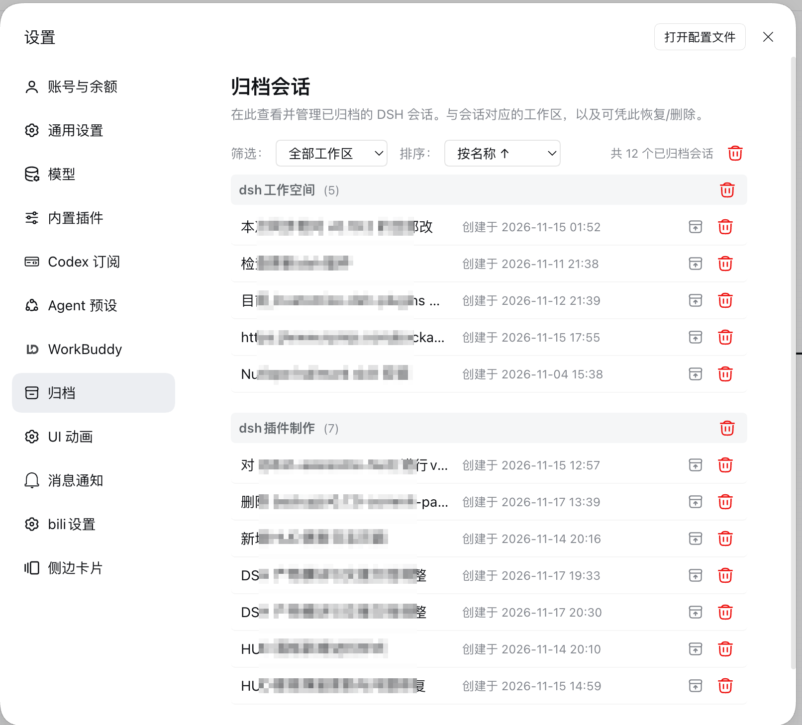
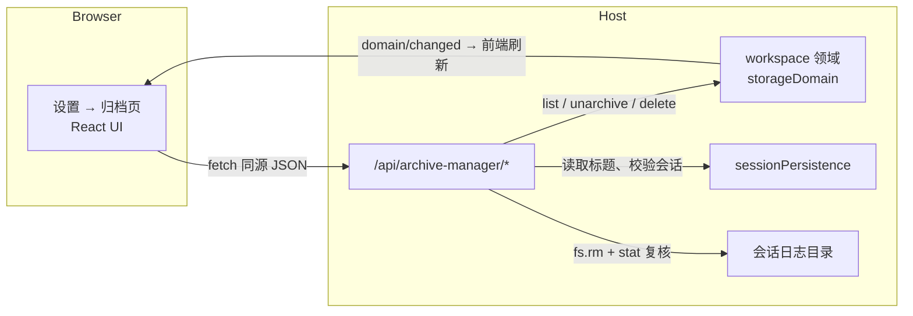

# dsh-archive-manager

[](README.md)
[](README_en.md)

<div align="center">

在 DSH 设置窗口新增「归档」页：查看、筛选、排序、取消归档并彻底删除已归档会话。

[](LICENSE)
[](package.json)
[](https://github.com/deepseek-ai/deepseek-harness)

</div>

---

## 📸 界面预览



*按工作区分组的归档列表 + 筛选/排序工具条；取消归档与删除均为图标按钮。截图中的会话名称已做模糊处理。*

---

## 📑 目录

- [✨ 功能特性](#-功能特性)
- [🚀 快速开始](#-快速开始)
- [📖 使用说明](#-使用说明)
- [🧱 工作原理](#-工作原理)
- [🧹 删除范围](#-删除范围)
- [🔌 API 与配置](#-api-与配置)
- [🚧 兼容性与限制](#-兼容性与限制)
- [🧾 更新日志](#-更新日志)
- [🤝 贡献与开发](#-贡献与开发)
- [📄 许可证](#-许可证)

---

## ✨ 功能特性

| 能力 | 说明 |
|------|------|
| **归档总览** | 在设置窗口新增「归档」页，列出全部已归档会话，并按工作区（workspace）分组；不属于任何工作区的会话归入「(未分组)」 |
| **筛选** | 按「全部工作区」、某个具体工作区或「未分组」过滤；筛选菜单只列出**至少有一个已归档会话**的工作区 |
| **排序** | 按会话名称（字母序）或创建时间排序，支持升/降序 |
| **名称悬停提示** | 鼠标在会话名称上停留 250ms 后，在鼠标位置显示完整名称（短名称同样显示）；气泡随鼠标移动并自动收进视口 |
| **取消归档** | 一键把会话移出归档集合，会话**重新出现在侧边栏对应工作区**，可继续打开 |
| **单条删除** | 红色垃圾桶图标；二次确认后彻底删除该会话及其聊天记录 |
| **按工作区删除** | 每个分组头部有整组删除图标，只删除该组的归档会话；「未分组」组同样支持 |
| **删除全部** | 顶栏图标删除全部归档会话（不受当前筛选影响），计数展示全部归档数 |
| **彻底清理** | 同时清理日志目录、归档标记、工作区记账、投影缓存与浏览器端分会话状态，详见[删除范围](#-删除范围) |
| **多语言界面** | 界面文案跟随 DSH 活动语言（中文 / English） |

> [!WARNING]
> 「删除」「删除本组」「删除全部」都是**不可恢复**的彻底删除。确认弹窗的主按钮为红字红描边样式，但仍请在操作前确认会话范围。

---

## 🚀 快速开始

### 30 秒安装

```sh
dsh plugin --profile web add dsh-archive-manager-ycet
```

### 启动

```sh
dsh web
```

打开终端中 `dsh web` 打印的地址（默认 <http://127.0.0.1:3080>）并刷新页面，点击左下角 **设置** → **归档**。

> [!NOTE]
> 桌面端把 `--profile web` 换成 `--profile desktop`，并使用桌面端自带的 CLI。首次安装后如果没有出现「归档」页，请重启 `dsh web` 或刷新页面。

### 环境要求

| 项目 | 要求 |
|------|------|
| DSH | `>= 0.2.1-rc.2`（由 `engines.dsh` 声明） |
| 运行端 | Web 端 / 桌面端 |
| 操作系统 | Windows / macOS |
| 工具链 | 已安装 DSH CLI 与 pnpm（`dsh plugin` 内部转发到 pnpm） |

### 其他安装方式

<details>
<summary>本地源码 / GitHub tag / Release tarball</summary>

```sh
# 本地源码（开发调试）
dsh plugin --profile web add dsh-archive-manager-ycet@link:<absolute-path-to-plugin>

# GitHub（锁定版本 tag，需要本机有 git）
dsh plugin --profile web add "github:Ycet/dsh-archive-manager#v0.4.2"

# Release 资产（tarball，无需 git、无需 npm 账号）
dsh plugin --profile web add "https://github.com/Ycet/dsh-archive-manager/releases/download/v0.4.2/dsh-archive-manager-ycet-0.4.2.tgz"
```

包内声明了 `dsh.bundle` 补丁层，`dsh plugin` 会自动把加载项合入 profile，无需手动编辑 `cordis.patch.yml`。

以上三种方式均无需 npm 账号。

</details>

> [!NOTE]
> npm 上无作用域的 `dsh-archive-manager` 是**另一位作者**的包（`jasonrale`，1.1.1），与本项目无关；本项目发布名为 `dsh-archive-manager-ycet`。

> [!NOTE]
> 以 `file:` 快照（拷贝）方式安装时，修改源码后需要重新执行安装命令同步 profile 内的快照，并重启 DSH web；bundle 层变更不会热加载。

---

## 📖 使用说明

### 打开归档页

1. 点击左侧边栏底部的 **设置**；
2. 在设置窗口左侧选择 **归档**。

### 工具条

| 控件 | 行为 |
|------|------|
| **筛选** | 默认「全部工作区」；可切换某个工作区或「未分组」。菜单只列出有归档会话的工作区，且仅当存在未分组会话时才显示「未分组」 |
| **排序** | 按名称 / 创建时间升序或降序 |
| **删除全部**（红色垃圾桶图标） | 删除**全部**归档会话，不受筛选影响，需二次确认 |

### 会话行与分组

| 操作 | 行为 |
|------|------|
| **名称** | 悬停 250ms 后在鼠标位置显示完整标题；长标题在气泡内换行，气泡随鼠标移动并自动避开视口边缘 |
| **取消归档**（DSH 取消归档图标） | 会话恢复到左侧边栏对应工作区，可点击打开 |
| **删除**（红色垃圾桶图标） | 二次确认后彻底删除该会话 |
| **删除本组**（分组头部红色垃圾桶图标） | 二次确认后只删除该工作区的归档会话；「未分组」组同样可用 |

确认弹窗会显示会话名（或工作区名）与数量；只有点击 **确认删除** 才会执行。删除完成后，归档页与左侧边栏会立即刷新。

---

## 🧱 工作原理

客户端通过官方 `settings.section` 槽位挂载「归档」页（导航图标走 `settings.section.icon`，旧版壳由 DOM 钩子兜底）；Host 半区不新增公共 RPC，也不挂载新 Service，只注册 5 条**包内同源** HTTP 路由。归档状态读写 DSH 的 `workspace` 领域，删除动作额外清理会话日志与派生数据。



### 技术栈

| 层 | 实现 |
|----|------|
| Host | DSH Cordis 插件（ESM），注册同源 HTTP 路由 |
| Client | 手写浏览器 bundle（lazy-CJS），React 18，使用 `settings.section` 插槽 |
| 数据 | DSH `workspace` 领域（`storageDomain`）、`sessionPersistence`、文件系统 |
| 测试 | Node.js 内置 `node:test` |

<details>
<summary>归档状态存在哪里？</summary>

DSH 把归档状态持久化在 `~/.dsh/storages/workspace.json`（workspace 领域）：

```jsonc
{
  "global": {
    "initialized": true,
    "workspaceIds": ["..."],
    "archivedSessionIds": ["session-xxx", "..."]
  },
  "tables": {
    "workspaces": {
      "<workspaceId>": {
        "path": "/abs/path",
        "title": "工作区名",
        "sessionIds": ["..."],
        "createdAt": "...",
        "updatedAt": "..."
      }
    }
  }
}
```

`archivedSessionIds` 是全局归档集合。归档只会把会话从各分区视图隐藏，**不会删除**日志、也不改变工作区记账，因此取消归档后可以恢复到原工作区位置。

</details>

<details>
<summary>为什么直接读写 workspace 领域？</summary>

DSH 主机端的 `workspaceRegistry` 只暴露 `archiveSession`，没有官方的 `unarchiveSession`，也没有「删除会话」接口。本插件因此直接读写 `storageDomain.get('workspace')`：

- 写入严格保持 `workspace.json` 的 schema 结构不变（数组整体替换后写回），DSH 启动时的领域校验可以通过。
- 写入 global 会触发 `domain/changed`，DSH 向浏览器推送 `host/archived-sessions-changed`，侧边栏与归档页即时刷新。
- DSH 的 `WorkspaceRegistry` 是单一写入者，其 `archivedSessionIds` getter 直接读内存 `state`。插件改写存储时会同步更新 `registry.state.archivedSessionIds`，并用官方 `WorkspaceEntity.detachSession` 移除工作区记账，避免「取消归档后再归档、硬刷新后会话消失」。

</details>

<details>
<summary>删除的执行顺序与一致性保护</summary>

1. 校验会话确实存在于 `archivedSessionIds`；未归档会话不会被操作。
2. 如果是 live 会话：仅当 agent 真正运行中（`agent.status === "running"`）才拒绝删除；空闲 live 会话先调用 `sessions.detachEntered` 从内存移除，让前端侧边栏立即消失。
3. 调用 `sessionPersistence.flush()` 排空日志写入；缺少该能力或调用失败时拒绝清除归档标记。DSH 0.1.5-rc.1 的 `sessionPersistence.list()` 返回 `{ header, revision }` 快照，本插件做了兼容解包，支持自定义存储根目录与合法的 `_no-cwd` 路径。
4. 定位并删除会话日志目录，使用 `stat(id)` 复核删除结果；**只有日志删除成功后**才移除归档标记与工作区记账，删除失败时归档状态保持不变，会话不会「复活」到侧边栏。列表读取失败、快照格式不兼容、仍能查到会话或无法定位已列出的会话时，也会保留归档标记并报错。
5. 最后清理投影缓存与浏览器端分会话状态；这一步失败不回滚已完成的删除，只在成功提示中附带说明。

</details>

---

## 🧹 删除范围

> [!WARNING]
> 删除操作不可恢复。执行前请确认会话名与删除范围。

**会清理**：

| 目标 | 位置 | 通道 |
|------|------|------|
| 会话日志目录 | `<DSH_HOME>/sessions/<项目目录>/<sessionId>/` | 文件系统删除 + `stat` 复核 |
| 归档标记 | `storages/workspace.json` 的 `archivedSessionIds` | 官方 registry API |
| 工作区记账 | `storages/workspace.json` 的 `tables.workspaces[*].sessionIds` | `detachSession` |
| 投影缓存 | `storages/session_projcache/sessions/<sessionId>.json` | 官方 `storageDomain` 领域 API（磁盘与内存同时失效） |
| 浏览器分会话状态 | localStorage：`dsh.sidebar-right.v1.*`、`dsh.conversation.*`、`dsh.user-questions.drafts.v1.*`、`dsh.sidebar-browser.v1.*` | 页面侧 `removeItem` |
| 「上次打开的会话」指针 | localStorage `dsh.sessions.current`（仅当指向被删会话） | 页面侧 `removeItem` |

**不会清理**（附原因）：

| 目标 | 原因 |
|------|------|
| 附件对象 `attachments/v1/objects/*` | 内容寻址去重存储，同一张图可能被多个会话共享，**没有引用计数**；按会话删除会打坏其他会话的图片 |
| `diff-review/sessions/*.json` | 早期版本遗留的快照目录，当前 DSH 与插件均不再写入 |
| `storages/session_projcache.json` | 新版逐条存储之前的旧版整文件格式，新后端不再读取；手动改动可能干扰其 `backup-and-skip` 恢复策略 |
| 会话搜索索引 | 当 profile 的 `sessionQuery` 使用 `path: ':memory:'`（当前配置）时，索引只在内存中，进程退出即消失，磁盘上没有需要清理的索引文件 |

**失败语义**：日志删除失败会让整个操作失败并保留归档状态；投影缓存或 localStorage 清理失败只记录日志并在成功提示中附带说明，不回滚已完成的删除。批量删除时每个会话独立判定，派生数据残留计入 `cacheFailures`，不影响 `deleted` 计数。「删除本组」由客户端只传 `workspaceId`，服务端按权威归档报告重新过滤目标会话。

<details>
<summary>投影缓存的已知竞态</summary>

DSH 在 `session/disposed` 时用 fire-and-forget 方式落盘检查点（`void flushSoft(...)`），插件现有的 `persistence.flush()` 只排空日志写入，排不空这次写回。如果写回晚于删除，`<id>.json` 可能被重建。插件用「删除后复核 + 最多 3 次重试（间隔 150ms）」应对，仍残留时会在提示中如实说明；重启 DSH 可以彻底清除。

</details>

---

## 🔌 API 与配置

本插件**无需任何环境变量或配置文件**，也不新增 DSH 公共 RPC、不挂载新 Service。它只注册 5 条包内同源路由，供归档页调用：

| 方法 | 路径 | 用途 |
|------|------|------|
| `GET` | `/api/archive-manager/list` | 返回归档会话与工作区清单 |
| `POST` | `/api/archive-manager/unarchive` | 取消归档单个会话 |
| `POST` | `/api/archive-manager/delete` | 彻底删除单个归档会话 |
| `POST` | `/api/archive-manager/delete-all` | 彻底删除全部归档会话 |
| `POST` | `/api/archive-manager/delete-workspace` | 按 `workspaceId` 删除某个工作区（或未分组，传 `null`）的归档会话 |

> [!NOTE]
> 这些路由仅供本插件页面使用，不是稳定的公共 API，后续版本可能调整。

---

## 🚧 兼容性与限制

- **DSH 版本**：要求 `>= 0.2.1-rc.2`；设置分区图标优先走官方 `settings.section.icon`，旧版壳由 DOM 钩子兜底。
- **Web 与桌面端**：两端共用同一份客户端 bundle；Windows / macOS 均可用。
- **仅操作归档会话**：删除与取消归档前都会校验会话确实存在于归档集合，未归档会话不会被误删或误改。
- **触屏设备**：名称悬停提示依赖鼠标 hover，触屏下不会出现；其余功能不受影响。
- **删除不可恢复**：日志、归档标记与工作区记账会一并移除；附件等共享数据不会删除，详见[删除范围](#-删除范围)。
- **子代理会话行**：前端收到 `api-session/removed` 时，若该行 `origin === "subagent"` 或被 address 保留，DSH 会把「删除行」降级为 `running: false` 而不移除该行；这类会话请以硬刷新后的结果为准。
- **投影缓存残留**：删除后若仍看到缓存残留提示，重启 DSH 即可彻底清除，不影响会话本身已被删除的结论。

---

## 🧾 更新日志

- **0.4.2**：会话名称增加 250ms 悬停提示，气泡跟随鼠标并自动收进视口；中英文 README 重构并替换界面截图。
- **0.4.1**：取消归档与删除按钮统一为图标；删除确认弹窗主按钮改为红字红描边透明底。

<details>
<summary>0.4.0 及更早</summary>

- **0.4.0**：新增按工作区一键删除；修复改名后客户端注册 id 未同步；顶栏删除全部计数改为全部归档数。
- **0.3.0**：删除时同步清理投影缓存与浏览器端分会话状态；派生数据清理失败不阻断主流程。
- **0.2.1**：设置导航图标改走官方 `settings.section.icon` 插槽，旧壳保留 DOM 兜底；补充 `engines.dsh` 兼容性门禁。
- **0.2.0**：设置页支持筛选、排序与二次确认删除。
- 更早版本见 [GitHub Releases](https://github.com/Ycet/dsh-archive-manager/releases)。

</details>

---

## 🤝 贡献与开发

欢迎提交 Issue 与 Pull Request。反馈问题时请附上 DSH 版本、插件版本、复现步骤与相关日志：[Issues](https://github.com/Ycet/dsh-archive-manager/issues)。

```sh
# 在插件目录内运行
npm test        # Node.js node:test 单元测试
npm run check   # 语法检查 index.js 与 client.js
```

部分集成测试需要设置 `DSH_TEST_INSTALL_ROOT` 指向本机 DSH 安装目录；未设置时会自动跳过，不作为失败。

| 路径 | 作用 |
|------|------|
| `index.js` | Host 半区：注册同源路由、读写 workspace 领域、执行删除与清理 |
| `client.js` | 浏览器半区：注册「归档」设置页、渲染分组/筛选/排序/弹窗/图标按钮 |
| `cordis.patch.yml` | `dsh.bundle` 补丁层声明 |
| `test/*.test.mjs` | Host 行为、客户端槽位与 localStorage 清理测试 |
| `assets/` | README 截图与图标来源文件 |

修改流程：Fork → 新建分支 → 提交 PR。Host 改动在 `index.js`，浏览器端改动在 `client.js`；涉及界面时请附截图或录屏。

---

## 📄 许可证

本项目使用 [MIT](LICENSE) 许可证。
