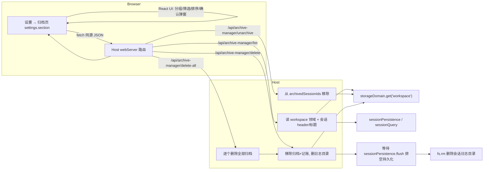

# dsh-archive-manager

[](README.md)
[](README_en.md)

<div align="center">

DeepSeek Harness（DSH）Web 界面插件：在设置窗口新增「归档」页，查看、筛选、排序、取消归档与彻底删除已归档会话。

[](LICENSE)
[](package.json)
[](https://github.com/deepseek-ai/deepseek-harness)

</div>

---

## 📑 目录

- [📸 界面预览](#-界面预览)
- [✨ 功能特性](#-功能特性)
- [🚀 快速开始](#-快速开始)
- [📖 使用说明](#-使用说明)
- [🔧 工作原理](#-工作原理)
- [⚠️ 技术说明与限制](#️-技术说明与限制)
- [⚙️ 配置说明](#️-配置说明)
- [🤝 贡献](#-贡献)
- [📄 许可证](#-许可证)

---

> [!NOTE]
> `0.3.0` 让「删除」真正清干净：除原有的日志目录，还会移除该会话的**投影缓存**（走官方 `storageDomain` 领域 API，磁盘与内存同时失效）与**浏览器端分会话状态**（侧栏布局、输入框草稿、追问草稿、侧栏浏览器状态，以及指向它的「上次打开的会话」指针）。派生数据清理失败不会阻断主流程，只在成功提示里附带说明。
>
> `0.2.1` 修正与 DSH 0.2.2-rc.1 的兼容问题：设置导航图标改走官方 `settings.section.icon` 插槽（注册 id 必须等于分区 id `archives`），旧版壳继续由 DOM 钩子兜底，两条路径靠 svg 上的 `data-dsh-archive-injected` 标记互斥；同时补上 `engines.dsh: >=0.2.1-rc.2`，让 DSH 的插件兼容性门禁对本事生效。

## 📸 界面预览


*工作区分组列表 + 筛选/排序工具条*

---

## ✨ 功能特性

| 功能 | 说明 |
|------|------|
| **查看已归档会话** | 设置窗口新增「归档」页，列出所有已归档会话，并按工作区（workspace）分组；不属于任何工作区的会话归入「(未分组)」 |
| **筛选** | 按「全部工作区」、某个具体工作区或「未分组」过滤归档会话；筛选菜单只列出**至少有一个已归档会话**的工作区，仅当存在未分组归档会话时才出现「未分组」选项 |
| **排序** | 按会话名称（字母序升/降）、按会话创建时间（升/降）两种维度排序 |
| **取消归档** | 会话从归档集合中移除，并**重新出现在左侧边栏对应工作区分组**中，可点击打开聊天窗口 |
| **删除（二次确认）** | 可删除单个会话，或一次「删除全部」；所有删除操作都弹出二次确认弹窗，仅点击「确认删除」才真正执行 |
| **彻底删除** | 删除会移除会话日志文件（`session.jsonl.zstd`）、归档标记及工作区记账，不可恢复 |
| **多语言界面** | 界面文案跟随 DSH 活动语言（中文 / English） |

---

## 🚀 快速开始

### 前提条件

- 已安装 DSH CLI 与 pnpm（`dsh plugin` 内部转发到 pnpm）

### 安装

```sh
# 方式一：从 npm 安装（发布包）
dsh plugin --profile web add @ycet/dsh-archive-manager

# 方式二：从本地源码安装（开发）
dsh plugin --profile web add @ycet/dsh-archive-manager@link:<absolute-path-to-plugin>

# 方式三：从 GitHub 安装（锁定版本 tag，需本机有 git）
dsh plugin --profile web add "github:Ycet/dsh-archive-manager#v0.3.0"

# 方式四：从 Release 资产安装（tarball，无需 git、无需 npm 账号）
dsh plugin --profile web add "https://github.com/Ycet/dsh-archive-manager/releases/download/v0.3.0/dsh-archive-manager-0.3.0.tgz"
```

包声明了 `dsh.bundle` 补丁层，`dsh plugin` 会自动把加载项合入 profile 的 bundle 层，无需手动编辑 `cordis.patch.yml`。方式二、三、四均无需 npm 账号；桌面端把 `--profile web` 换成 `--profile desktop`（使用桌面端自带 CLI）。

> [!NOTE]
> npm 上无作用域的 `dsh-archive-manager` 是**另一位作者的包**（`jasonrale`，版本 1.1.1），与本项目无关。本项目发布为 `@ycet/dsh-archive-manager`。

### 启动

1. 重启网页应用：`dsh web`
2. 打开 http://127.0.0.1:3080 并刷新页面
3. 点击左侧边栏底部的**设置**，选择**归档**页面

> [!NOTE]
> 安装为 `file:` 快照（拷贝）时，修改源码后需重新执行安装命令同步 profile 内的快照，再重启 DSH web 生效（bundle 层变更必须重启 DSH，不热加载）。

---

## 📖 使用说明

1. 点击左侧边栏底部的 **设置**；
2. 在设置窗口左侧选择 **归档** 页面；
3. 页面上方工具条：
   - **筛选**下拉：默认「全部工作区」，可选某个具体工作区或「未分组」；菜单只列出**至少有一个已归档会话**的工作区（某工作区没有任何归档会话时不出现在菜单中），仅当存在未分组归档会话时才出现「未分组」选项；
   - **排序**下拉：按名称或创建时间升/降序；
   - **删除全部**按钮：删除当前筛选下全部已归档会话（需二次确认）；
4. 会话按工作区分组展示，每组含会话标题与创建时间：
   - **取消归档**：会话恢复到左侧边栏对应工作区分组，可点击打开；
   - **删除**：二次确认后彻底删除该会话。

---

## 🔧 工作原理

### 归档在 DSH 中的底层存储

DSH 的会话归档状态持久化在 `~/.dsh/storages/workspace.json`（workspace 领域）：

```jsonc
{
  "global": {
    "initialized": true,
    "workspaceIds": ["..."],
    "archivedSessionIds": ["session-xxx", "..."],
  },
  "tables": {
    "workspaces": {
      "<workspaceId>": {
        "path": "/abs/path",
        "title": "工作区名",
        "sessionIds": ["..."],
        "createdAt": "...",
        "updatedAt": "..."
      }
    }
  }
}
```

`archivedSessionIds` 是全局归档集合。归档只把会话从各分区视图隐藏，**不删除**日志、不改变工作区记账，因此取消归档后可恢复到原工作区位置。

### 数据流



主机端写入 `workspace` 领域 global 后，DSH 启动时会校验领域状态（fail-loud）。写入严格保持 `workspace.json` 的 schema 结构不变（数组整体替换后写回），不会破坏 DSH 启动。

---

## ⚠️ 技术说明与限制

- **无官方 unarchive / 删除会话 API**：DSH 主机端 `workspaceRegistry` 只暴露 `archiveSession`，没有 `unarchiveSession`，也没「删除会话」接口。本插件直接读写 `storageDomain.get('workspace')` 领域存储（`~/.dsh/storages/workspace.json`），严格保持其 schema。
- **删除为彻底删除**：见下方「删除范围」。日志目录删除不可恢复。
- **删除先删文件、后清记录**：删除时先定位会话日志目录，**确认日志文件删除成功后**才移除归档标记与工作区记账；若日志删除失败（无法定位、仍存在、IO 错误），返回错误且**不改动归档状态**——会话保持隐藏，不会「复活」到侧边栏。派生数据清理排在这一步之后，失败不回滚。
- **持久化快照兼容与删除复核**：DSH 0.1.5-rc.1 的 `sessionPersistence.list()` 返回 `{ header, revision }`，不是裸 header。此前直接读取条目的 `id` / `cwd`，导致找不到真实会话；路径兜底也失败时，误判日志不存在并清除归档标记，使仍在磁盘的会话重新显示。现在统一解包快照（兼容旧版裸 header），优先用实际 header 调用 `locate()`，支持自定义存储根目录与合法的 `_no-cwd` 路径；删除后通过可用的 `stat(id)` 复核。列表读取失败、格式不兼容、仍能查到会话或无法定位已列出的会话时，均保留归档标记并报错。
- **live 持久化排空防护**：保留摘除空闲 live 会话后 `await sessionPersistence.flush()` 的防护；缺少该能力或调用失败时拒绝清除归档标记。该屏障排空当前活跃的 write handles，但上一轮将异步写回认定为本问题根因的结论未经真实后端复现；本轮实际复现并修复的是快照结构解析错误。
- **运行中即时生效**：写入 global 会触发 `domain/changed`，DSH 会向浏览器推送 `host/archived-sessions-changed`，侧边栏与归档页即时刷新。
- **内存缓存一致性（已修复）**：DSH 的 `WorkspaceRegistry` 是单一写入者，其 `archivedSessionIds` getter 直接读内存 `state`。本插件改写存储时会**同步更新 `registry.state.archivedSessionIds`**，并用官方 `WorkspaceEntity.detachSession` 移除工作区记账（同时更新 entity.record 缓存）；因此取消归档后再归档、硬刷新重建基线都不会出现会话消失/不显示的问题。
- **仅支持归档会话**：删除/取消归档前会校验该会话确实存在于 `archivedSessionIds`，对未归档会话不会操作。
- **live 会话处理（已修复）**：agent 结束后的会话仍会作为 live Session 留在 DSH 内存（`ctx.sessions`），仅删文件不会让前端移除它（`session.list` 的 live 部分仍返回，侧边栏显示「复活」）。删除时若会话是 live：**仅当 agent 真正运行中（`agent.status === "running"`）才拒绝删除**；空闲 live（agent idle 或没有 agent）→ 先调用 `sessions.detachEntered` 将其从内存移除（触发 `session/disposed` → DSH 推送 `api-session/removed` → 前端侧边栏立即移除，agent-loop 也会自动清理关联的 idle agent），**再等待持久化排空屏障**，之后才删文件与清记录（避免 DSH 的异步最终 drain 把日志写回磁盘）。
  - 注意：前端收到 `api-session/removed` 时，若该行 `origin === "subagent"` 或被 address 保留，DSH 会把「删除行」降级为「running=false」而不移除该行；此类会话请以硬刷新后的结果为准。

> [!WARNING]
> 「删除」与「删除全部」均为**彻底删除**：会话日志文件、归档标记与工作区记账会被一并移除，**不可恢复**。

### 删除范围

DSH 本身不提供会话删除或回收能力（官方说明见 `@deepseek-ai/dsh-session-persistence` 的 “No deletion or retention API”，清理被明确划为带外维护），且多个存储层都声明「不会自动清理」。本插件在删除日志之外，尽量补上能安全清理的派生数据。

**会清理**：

| 目标 | 位置 | 通道 |
|---|---|---|
| 会话日志目录 | `<DSH_HOME>/sessions/<项目目录>/<sessionId>/` | 文件系统删除 + `stat` 复核 |
| 归档标记 | `storages/workspace.json` 的 `archivedSessionIds` | 官方 registry API |
| 工作区记账 | `storages/workspace.json` 的 `tables.workspaces[*].sessionIds` | `detachSession` |
| 投影缓存 | `storages/session_projcache/sessions/<sessionId>.json` | **官方 `storageDomain` 领域 API**（磁盘与内存同时失效） |
| 浏览器分会话状态 | localStorage：`dsh.sidebar-right.v1.*`、`dsh.conversation.*`、`dsh.user-questions.drafts.v1.*`、`dsh.sidebar-browser.v1.*` | 页面侧 `removeItem` |
| 「上次打开的会话」指针 | localStorage `dsh.sessions.current`（仅当指向被删会话） | 页面侧 `removeItem` |

**不会清理**（附原因）：

| 目标 | 原因 |
|---|---|
| 附件对象 `attachments/v1/objects/*` | 内容寻址去重存储，同一张图被多个会话共享一份字节，**没有引用计数**。官方明确「不会自动删除，也没有回收未引用对象的机制」。按会话定向删除会连带打坏其他会话的图片，因此不做。 |
| `diff-review/sessions/*.json` | 早期版本遗留的快照目录，当前 DSH 与插件均不再写入。 |
| `storages/session_projcache.json` | 新版逐条存储之前的旧版整文件格式，新后端不再读取；手动改动可能干扰其 `backup-and-skip` 恢复策略。 |
| 会话搜索索引 | 当前 profile 的 `sessionQuery` 配置为 `path: ':memory:'`（`openAt: first-search`），索引只存在于内存，进程退出即消失，磁盘上没有任何索引文件需要清理。 |

**失败语义**：日志删除失败 → 整体失败、归档状态不变；投影缓存或 localStorage 清理失败 → 只记日志并在成功提示中附带说明，**不回滚**已完成的删除。删除「全部」时，每个会话独立判定，派生数据残留计入 `cacheFailures` 而不影响 `deleted` 计数。

> [!NOTE]
> 投影缓存有一个已知竞态：DSH 在 `session/disposed` 时用 fire-and-forget 方式落盘检查点（`void flushSoft(...)`，没有 `await`），插件现有的 `persistence.flush()` 只排空日志写入、排不空它。若那次写回晚于本次删除，`<id>.json` 可能被重建。插件以「删除后复核 + 最多 3 次重试（间隔 150ms）」应对，仍残留时如实上报——重启 DSH 即可彻底清除。

---

## ⚙️ 配置说明

本插件无需任何环境变量或配置文件，开箱即用。它不新增 DSH 公共 RPC、不挂载新 Service，仅注册 4 条包内同源 HTTP 路由：

| 方法 | 路径 | 用途 |
| --- | --- | --- |
| `GET` | `/api/archive-manager/list` | 返回归档会话 + 工作区清单 |
| `POST` | `/api/archive-manager/unarchive` | 取消归档单个会话 |
| `POST` | `/api/archive-manager/delete` | 彻底删除单个归档会话 |
| `POST` | `/api/archive-manager/delete-all` | 彻底删除全部归档会话 |

---

## 🤝 贡献

欢迎提交 Issue 与 Pull Request：发现问题请携带 DSH 版本、插件版本、复现步骤与日志到 [Issues](https://github.com/Ycet/dsh-archive-manager/issues) 反馈；改进请按 Fork → 分支 → PR 流程提交（主机端修改 `index.js`，浏览器端修改 `client.js`）。

---

## 📄 许可证

本项目使用 [MIT](LICENSE) 许可证。
