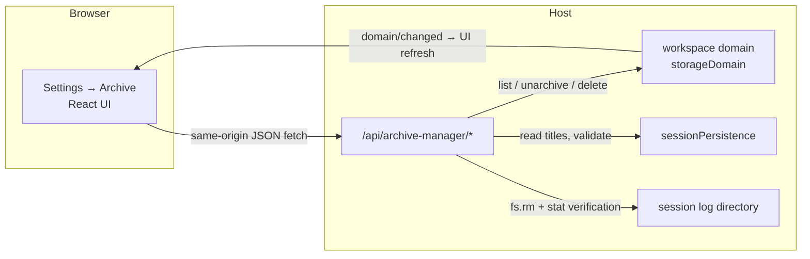

# dsh-archive-manager

[](README.md)
[](README_en.md)

<div align="center">

A DSH settings page to view, filter, sort, unarchive and permanently delete archived sessions.

[](LICENSE)
[](package.json)
[](https://github.com/deepseek-ai/deepseek-harness)

</div>

---

## 📸 Preview


*Workspace-grouped archive list with the filter/sort toolbar; unarchive and delete actions are icon buttons. Session names in the screenshot are blurred.*

---

## 📑 Table of Contents

- [✨ Features](#-features)
- [🚀 Quick Start](#-quick-start)
- [📖 Usage](#-usage)
- [🧱 How It Works](#-how-it-works)
- [🧹 Deletion Scope](#-deletion-scope)
- [🔌 API & Configuration](#-api--configuration)
- [🚧 Compatibility & Limitations](#-compatibility--limitations)
- [🧾 Changelog](#-changelog)
- [🤝 Contributing & Development](#-contributing--development)
- [📄 License](#-license)

---

## ✨ Features

| Feature | Description |
|---------|-------------|
| **Archive overview** | A new **Archive** page in Settings lists every archived session, grouped by workspace; sessions without a workspace go under "(Ungrouped)" |
| **Filter** | Filter by "All workspaces", a specific workspace, or "Ungrouped"; the dropdown only lists workspaces that **own at least one archived session** |
| **Sort** | Sort by session name (alphabetical) or creation time, ascending or descending |
| **Name hover tooltip** | After 250 ms over a session name, the full title appears at the pointer (short names included); the bubble follows the cursor and stays inside the viewport |
| **Unarchive** | Move a session out of the archive set so it **reappears in its workspace in the sidebar** and can be opened again |
| **Delete one** | Red trash icon; after a second confirmation, permanently deletes that session and its chat history |
| **Delete per workspace** | Each group header has a delete-group icon that removes only that group's archived sessions; the "Ungrouped" group is supported too |
| **Delete all** | Toolbar icon that deletes every archived session (regardless of the current filter); the count shows all archived sessions |
| **Deep cleanup** | Removes the log directory, archive marker, workspace bookkeeping, projection cache and browser-side per-session state — see [Deletion Scope](#-deletion-scope) |
| **Bilingual UI** | UI text follows DSH's active language (Chinese / English) |

> [!WARNING]
> "Delete", "Delete group" and "Delete all" are **irreversible**. The confirm button uses red text with a red outline, but always double-check the scope before confirming.

---

## 🚀 Quick Start

### Install in 30 seconds

```sh
dsh plugin --profile web add dsh-archive-manager-ycet
```

### Launch

```sh
dsh web
```

Open the address printed by `dsh web` (default <http://127.0.0.1:3080>), refresh the page, then click **Settings** → **Archive** at the bottom of the left sidebar.

> [!NOTE]
> For the desktop app, replace `--profile web` with `--profile desktop` and use the CLI bundled with the desktop app. If the **Archive** page does not appear after installation, restart `dsh web` or refresh the page.

### Requirements

| Item | Requirement |
|------|-------------|
| DSH | `>= 0.2.1-rc.2` (declared via `engines.dsh`) |
| Runtime | Web and desktop app |
| OS | Windows and macOS |
| Toolchain | DSH CLI and pnpm installed (`dsh plugin` forwards to pnpm internally) |

### Other install options

<details>
<summary>Local source / GitHub tag / Release tarball</summary>

```sh
# Local source (development)
dsh plugin --profile web add dsh-archive-manager-ycet@link:<absolute-path-to-plugin>

# GitHub (pinned release tag; requires git)
dsh plugin --profile web add "github:Ycet/dsh-archive-manager#v0.4.2"

# Release asset (tarball; no git, no npm account)
dsh plugin --profile web add "https://github.com/Ycet/dsh-archive-manager/releases/download/v0.4.2/dsh-archive-manager-ycet-0.4.2.tgz"
```

The package declares a `dsh.bundle` patch layer; `dsh plugin` merges the loader entry into the profile automatically — no manual editing of `cordis.patch.yml` is required.

None of these three options requires an npm account.

</details>

> [!NOTE]
> The unscoped `dsh-archive-manager` on npm belongs to **a different author** (`jasonrale`, 1.1.1) and is unrelated to this project. This project publishes as `dsh-archive-manager-ycet`.

> [!NOTE]
> When installed as a `file:` snapshot (copy), re-run the install command after changing the source to refresh the snapshot inside the profile, then restart DSH web; bundle-layer changes are not hot-reloaded.

---

## 📖 Usage

### Open the Archive page

1. Click **Settings** at the bottom of the left sidebar.
2. Select **Archive** in the settings window.

### Toolbar

| Control | Behavior |
|---------|----------|
| **Filter** | Defaults to "All workspaces"; switch to a specific workspace or "Ungrouped". The dropdown only lists workspaces with archived sessions, and "Ungrouped" appears only when such sessions exist |
| **Sort** | By name or creation time, ascending or descending |
| **Delete all** (red trash icon) | Deletes **all** archived sessions regardless of the filter, after a second confirmation |

### Session rows and groups

| Action | Behavior |
|--------|----------|
| **Session name** | After 250 ms of hover, a bubble shows the full title at the pointer; long titles wrap inside the bubble, which follows the cursor and avoids the viewport edges |
| **Unarchive** (DSH unarchive icon) | Restores the session to its workspace in the left sidebar, where it can be opened again |
| **Delete** (red trash icon) | Permanently deletes the session after a second confirmation |
| **Delete group** (red trash icon in the group header) | Deletes only that workspace's archived sessions after a second confirmation; the "Ungrouped" group works the same way |

The confirmation dialog shows the session (or workspace) name and count; nothing runs until **Confirm delete** is clicked. After deletion, both the Archive page and the sidebar refresh immediately.

---

## 🧱 How It Works

The client mounts the Archive page through the official `settings.section` slot (the nav icon uses `settings.section.icon`, with a DOM fallback for older shells). The host half adds no public RPC and mounts no new service; it only registers five **package-local same-origin** HTTP routes. Archive state is read from and written to DSH's `workspace` domain, while deletion also cleans session logs and derived data.



### Stack

| Layer | Implementation |
|-------|----------------|
| Host | DSH Cordis plugin (ESM) registering same-origin HTTP routes |
| Client | Hand-written browser bundle (lazy-CJS), React 18, `settings.section` slot |
| Data | DSH `workspace` domain (`storageDomain`), `sessionPersistence`, filesystem |
| Tests | Node.js built-in `node:test` |

<details>
<summary>Where is archive state stored?</summary>

DSH persists archive state in `~/.dsh/storages/workspace.json` (the workspace domain):

```jsonc
{
  "global": {
    "initialized": true,
    "workspaceIds": ["..."],
    "archivedSessionIds": ["session-xxx", "..."]
  },
  "tables": {
    "workspaces": {
      "<workspaceId>": {
        "path": "/abs/path",
        "title": "Workspace name",
        "sessionIds": ["..."],
        "createdAt": "...",
        "updatedAt": "..."
      }
    }
  }
}
```

`archivedSessionIds` is the global archive set. Archiving only hides a session from the partition views; it **does not** delete logs or change workspace bookkeeping, so unarchiving restores the session to its original workspace.

</details>

<details>
<summary>Why read and write the workspace domain directly?</summary>

The DSH host `workspaceRegistry` only exposes `archiveSession` — there is no official `unarchiveSession` and no "delete session" API. The plugin therefore reads and writes `storageDomain.get('workspace')` directly:

- Writes keep the `workspace.json` schema strictly unchanged (arrays are replaced wholesale), so DSH's fail-loud domain validation on startup still passes.
- Writing the global triggers `domain/changed`; DSH pushes `host/archived-sessions-changed` to the browser, so the sidebar and Archive page refresh immediately.
- DSH's `WorkspaceRegistry` is the single writer and its `archivedSessionIds` getter reads the in-memory `state` directly. When rewriting the store, the plugin synchronously updates `registry.state.archivedSessionIds` and uses the official `WorkspaceEntity.detachSession` to remove workspace bookkeeping, so archive → unarchive → archive cycles and hard-refresh baseline rebuilds do not lose sessions.

</details>

<details>
<summary>Deletion order and consistency safeguards</summary>

1. Verify the session really exists in `archivedSessionIds`; non-archived sessions are never touched.
2. For a live session: refuse deletion only when the agent is truly running (`agent.status === "running"`); an idle live session is first detached with `sessions.detachEntered` so the sidebar removes it immediately.
3. Call `sessionPersistence.flush()` to drain log writes; refuse to clear the archive marker when the capability is missing or fails. DSH 0.1.5-rc.1 returns `{ header, revision }` snapshots from `sessionPersistence.list()`; the plugin unpacks them (with legacy bare-header support) and supports custom storage roots and legitimate `_no-cwd` paths.
4. Locate and delete the session log directory, then verify the result with `stat(id)`. **Only after the logs are gone** does it remove the archive marker and workspace bookkeeping; on failure the archive state is left untouched, so the session cannot "resurrect" in the sidebar. A failed list read, an incompatible snapshot format, a session that is still resolvable, or a listed session that cannot be located also keep the archive marker and return an error.
5. Finally purge the projection cache and browser-side per-session state. A failure here does not roll back the deletion; it is only mentioned in the success notice.

</details>

---

## 🧹 Deletion Scope

> [!WARNING]
> Deletion is irreversible. Confirm the session name and scope before proceeding.

**Removed**:

| Target | Location | Channel |
|--------|----------|---------|
| Session log directory | `<DSH_HOME>/sessions/<project-dir>/<sessionId>/` | Filesystem delete + `stat` verification |
| Archive marker | `archivedSessionIds` in `storages/workspace.json` | Official registry API |
| Workspace bookkeeping | `tables.workspaces[*].sessionIds` in `storages/workspace.json` | `detachSession` |
| Projection cache | `storages/session_projcache/sessions/<sessionId>.json` | Official `storageDomain` domain API (disk and memory invalidated together) |
| Browser per-session state | localStorage: `dsh.sidebar-right.v1.*`, `dsh.conversation.*`, `dsh.user-questions.drafts.v1.*`, `dsh.sidebar-browser.v1.*` | Page-side `removeItem` |
| "Last opened session" pointer | localStorage `dsh.sessions.current` (only when it names the deleted session) | Page-side `removeItem` |

**Not removed** (with reasons):

| Target | Reason |
|--------|--------|
| Attachment objects `attachments/v1/objects/*` | Content-addressed deduplicated store: one image may be shared by several sessions with **no reference counting**; deleting per session would break other sessions' images |
| `diff-review/sessions/*.json` | Legacy snapshot directory from earlier versions; neither current DSH nor this plugin writes it |
| `storages/session_projcache.json` | Pre-per-record whole-unit format; the new backend no longer reads it, and manual edits could interfere with its `backup-and-skip` recovery policy |
| Session search index | When the profile configures `sessionQuery` with `path: ':memory:'` (the current setup), the index lives only in memory and leaves no index files on disk |

**Failure semantics**: a failed log deletion fails the whole operation and leaves archive state untouched; a failed projection-cache or localStorage cleanup is only logged and mentioned in the success notice, without rolling back the completed deletion. In batch deletes each session is judged independently; derived-data residue counts toward `cacheFailures` and never changes the `deleted` count. For delete-group, the client sends only `workspaceId`; the server re-filters the target sessions from the authoritative archive report.

<details>
<summary>Known projection-cache race</summary>

On `session/disposed` DSH persists a checkpoint fire-and-forget (`void flushSoft(...)`), and the plugin's `persistence.flush()` only drains log writes, not that checkpoint. If the write lands after deletion, `<id>.json` can reappear. The plugin re-verifies after deletion and retries up to 3 times at 150 ms intervals; if residue remains it reports that honestly. Restarting DSH clears it completely.

</details>

---

## 🔌 API & Configuration

The plugin needs **no environment variables or config files**, adds no public DSH RPC and mounts no new service. It registers five package-local same-origin routes used by the Archive page:

| Method | Path | Purpose |
|--------|------|---------|
| `GET` | `/api/archive-manager/list` | Return archived sessions and the workspace list |
| `POST` | `/api/archive-manager/unarchive` | Unarchive one session |
| `POST` | `/api/archive-manager/delete` | Permanently delete one archived session |
| `POST` | `/api/archive-manager/delete-all` | Permanently delete all archived sessions |
| `POST` | `/api/archive-manager/delete-workspace` | Delete a workspace's archived sessions (`workspaceId`, or `null` for ungrouped) |

> [!NOTE]
> These routes are for this plugin's page only; they are not a stable public API and may change between versions.

---

## 🚧 Compatibility & Limitations

- **DSH version**: requires `>= 0.2.1-rc.2`; the settings nav icon prefers the official `settings.section.icon` slot, with a DOM fallback for older shells.
- **Web and desktop**: both use the same client bundle; Windows and macOS are supported.
- **Archived sessions only**: delete and unarchive first verify that the session is in the archive set, so non-archived sessions are never modified.
- **Touch devices**: the name tooltip relies on mouse hover and does not appear on touch screens; all other features work normally.
- **Deletion is irreversible**: logs, archive markers and workspace bookkeeping are removed together; shared data such as attachments is not deleted — see [Deletion Scope](#-deletion-scope).
- **Subagent session rows**: when the frontend receives `api-session/removed` for a row whose `origin === "subagent"` (or whose id is address-retained), DSH downgrades row removal to a `running: false` flip and keeps the row; judge such sessions by the result after a hard refresh.
- **Projection-cache residue**: if a residue notice appears after deletion, restarting DSH clears it completely; the session itself is already deleted.

---

## 🧾 Changelog

- **0.4.2**: Added a 250 ms hover tooltip for session names; the bubble follows the cursor and stays within the viewport; rebuilt both READMEs with a fresh UI screenshot.
- **0.4.1**: Turned unarchive/delete actions into icon buttons; the delete confirm button now uses red text with a red outline on a transparent background.

<details>
<summary>0.4.0 and earlier</summary>

- **0.4.0**: Added per-workspace bulk delete; fixed the client registration id after the package rename; "Delete all" now counts all archived sessions.
- **0.3.0**: Deletion now also purges the projection cache and browser-side per-session state; derived-data cleanup failures do not block the main flow.
- **0.2.1**: Moved the settings nav icon to the official `settings.section.icon` slot, keeping the DOM fallback for older shells; added the `engines.dsh` compatibility gate.
- **0.2.0**: The settings page gained filtering, sorting and second-confirmation deletion.
- See [GitHub Releases](https://github.com/Ycet/dsh-archive-manager/releases) for earlier versions.

</details>

---

## 🤝 Contributing & Development

Issues and pull requests are welcome. When reporting a problem, include the DSH version, plugin version, reproduction steps and relevant logs: [Issues](https://github.com/Ycet/dsh-archive-manager/issues).

```sh
# Run inside the plugin directory
npm test        # Node.js node:test unit tests
npm run check   # Syntax-check index.js and client.js
```

Some integration tests require `DSH_TEST_INSTALL_ROOT` pointing at a local DSH installation; they are skipped automatically when it is not set and do not count as failures.

| Path | Purpose |
|------|---------|
| `index.js` | Host half: same-origin routes, workspace domain access, deletion and cleanup |
| `client.js` | Browser half: Archive settings page, grouping/filtering/sorting/dialogs/icon buttons |
| `cordis.patch.yml` | `dsh.bundle` patch-layer declaration |
| `test/*.test.mjs` | Host behavior, client slot and localStorage cleanup tests |
| `assets/` | README screenshot and icon source files |

Workflow: Fork → create a branch → open a PR. Host changes belong in `index.js`, browser changes in `client.js`; include a screenshot or recording for UI changes.

---

## 📄 License

This project is licensed under the [MIT](LICENSE) license.
