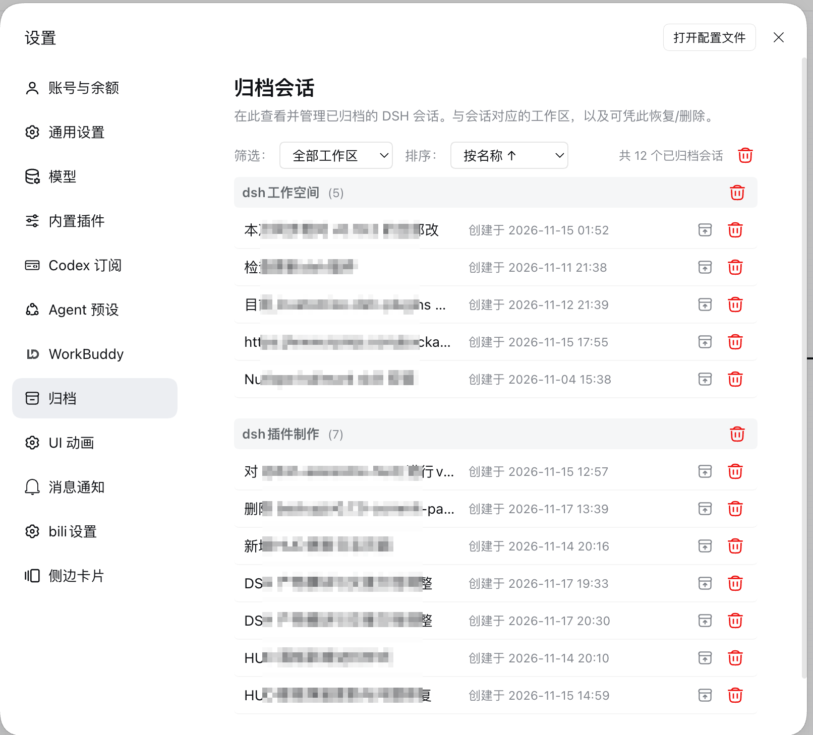
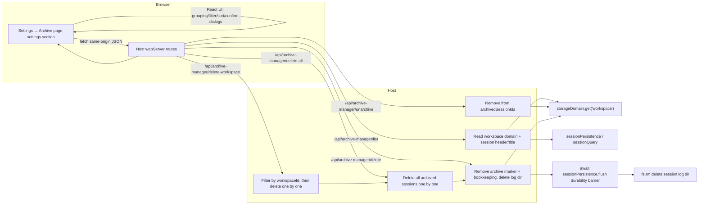

# dsh-archive-manager

[](README.md)
[](README_en.md)

<div align="center">

A DeepSeek Harness (DSH) web-GUI plugin: adds an "Archive" page to the settings window for viewing, filtering, sorting, unarchiving and permanently deleting archived DSH sessions.

[](LICENSE)
[](package.json)
[](https://github.com/deepseek-ai/deepseek-harness)

</div>

---

## 📑 Table of Contents

- [📸 Preview](#-preview)
- [✨ Features](#-features)
- [🚀 Quick Start](#-quick-start)
- [📖 Usage](#-usage)
- [🔧 How It Works](#-how-it-works)
- [⚠️ Technical Notes & Limitations](#️-technical-notes--limitations)
- [⚙️ Configuration](#️-configuration)
- [🤝 Contributing](#-contributing)
- [📄 License](#-license)

---

> [!NOTE]
> `0.4.0` adds **one-click deletion per workspace**: every workspace group header now has a "Delete group" button that permanently deletes only that group's archived sessions after a second confirmation, and the "Ungrouped" group works the same way. The toolbar "Delete all" still deletes everything, but its count now reflects all archived sessions instead of the filtered subset. This release also fixes the client registration id that was left at the old package name after the rename to `dsh-archive-manager-ycet`, which made the page report a plugin sync failure.
>
> `0.3.0` makes "Delete" actually clean up: besides the log directory, it now removes the session's **projection cache** (through the official `storageDomain` domain API, invalidating both disk and memory) and its **browser-side per-session state** (sidebar layout, composer draft, follow-up-question draft, sidebar-browser state, plus the "last opened session" pointer when it names the deleted session). A failed derived-data cleanup never blocks the main flow — it is only mentioned in the success notice.
>
> `0.2.1` fixed compatibility with DSH 0.2.2-rc.1: the settings nav icon now uses the official `settings.section.icon` slot (registered id must equal the section id `archives`), with the DOM hook kept as a fallback for older shells; the two paths are mutually exclusive via the `data-dsh-archive-injected` marker on the svg. It also added `engines.dsh: >=0.2.1-rc.2` so DSH's plugin compatibility gate applies to this package.

## 📸 Preview



*Workspace-grouped list + filter/sort toolbar*

---

## ✨ Features

| Feature | Description |
|---------|-------------|
| **View archived sessions** | A new "Archive" page in the settings window lists all archived sessions, grouped by workspace; sessions not belonging to any workspace go under "(Unassigned)" |
| **Filter** | Filter archived sessions by "All workspaces", a specific workspace, or "Ungrouped"; the dropdown only lists workspaces that **own at least one archived session**, and the "Ungrouped" option only appears when ungrouped archived sessions exist |
| **Sort** | Sort by session name (alphabetical asc/desc) or by session creation time (asc/desc) |
| **Unarchive** | Removes a session from the archive set; it **reappears in the corresponding workspace group in the left sidebar** and can be opened |
| **Delete (with confirmation)** | Delete a single session, delete every archived session of one workspace, or "Delete all" at once; every delete is guarded by a second confirmation dialog — it only runs after clicking "Confirm delete" |
| **Delete per workspace** | Each workspace group header has a "Delete group" button that deletes only that group's archived sessions; the "Ungrouped" group is supported too. The dialog names the workspace and session count, and sessions are deleted one by one with an aggregated result |
| **Permanent deletion** | Deletion removes the session log file (`session.jsonl.zstd`), the archive marker and the workspace bookkeeping — irreversible |
| **Bilingual UI** | UI text follows DSH's active language (中文 / English) |

---

## 🚀 Quick Start

### Prerequisites

- DSH CLI and pnpm installed (`dsh plugin` forwards to pnpm internally)

### Install

```sh
# Option 1: install from npm (published package)
dsh plugin --profile web add dsh-archive-manager-ycet

# Option 2: install from a local source directory (development)
dsh plugin --profile web add dsh-archive-manager-ycet@link:<absolute-path-to-plugin>

# Option 3: install from GitHub (pinned to a release tag; requires git)
dsh plugin --profile web add "github:Ycet/dsh-archive-manager#v0.4.0"

# Option 4: install from a Release asset (tarball; no git, no npm account)
dsh plugin --profile web add "https://github.com/Ycet/dsh-archive-manager/releases/download/v0.4.0/dsh-archive-manager-ycet-0.4.0.tgz"
```

The package declares a `dsh.bundle` patch layer; `dsh plugin` merges the loader entry into the profile's bundle layer automatically — no manual editing of `cordis.patch.yml` required. Options 2–4 need no npm account; for the desktop app replace `--profile web` with `--profile desktop` (using the desktop-bundled CLI).

> [!NOTE]
> The unscoped `dsh-archive-manager` on npm belongs to **a different author** (`jasonrale`, version 1.1.1) and is unrelated to this project. This project publishes as `dsh-archive-manager-ycet`.

### Launch

1. Restart the web app: `dsh web`
2. Open http://127.0.0.1:3080 and refresh the page
3. Click **Settings** at the bottom of the left sidebar, then choose the **Archive** page

> [!NOTE]
> When installed as a `file:` snapshot (copy), re-run the install command after changing the source to refresh the snapshot inside the profile, then restart DSH web for it to take effect (bundle-layer changes always require a DSH restart; they are not hot-reloaded).

---

## 📖 Usage

1. Click **Settings** at the bottom of the left sidebar;
2. Select the **Archive** page on the left of the settings window;
3. Toolbar at the top of the page:
   - **Filter** dropdown: default "All workspaces"; pick a specific workspace or "Ungrouped" to narrow down; the dropdown only lists workspaces that **own at least one archived session** (a workspace with no archived sessions does not appear), and the "Ungrouped" option only appears when ungrouped archived sessions exist;
   - **Sort** dropdown: by name or creation time, ascending or descending;
   - **Delete all** button: deletes **all** archived sessions (regardless of the filter, with confirmation);
4. Sessions are grouped by workspace, each group showing session titles and creation times:
   - **Delete group** (right side of the group header): after a second confirmation, deletes only that group's archived sessions; the dialog shows the workspace name and session count;
   - **Unarchive**: the session returns to its workspace group in the left sidebar and can be reopened;
   - **Delete**: permanently deletes the session after a second confirmation.

---

## 🔧 How It Works

### Underlying storage of archiving in DSH

DSH persists session archive state in `~/.dsh/storages/workspace.json` (the workspace domain):

```jsonc
{
  "global": {
    "initialized": true,
    "workspaceIds": ["..."],
    "archivedSessionIds": ["session-xxx", "..."],
  },
  "tables": {
    "workspaces": {
      "<workspaceId>": {
        "path": "/abs/path",
        "title": "Workspace name",
        "sessionIds": ["..."],
        "createdAt": "...",
        "updatedAt": "..."
      }
    }
  }
}
```

`archivedSessionIds` is the global archive set. Archiving only hides a session from the partition views; it **does not** delete logs or change workspace bookkeeping, so unarchiving restores the session to its original workspace.

### Data flow



After the host writes the `workspace` domain global, DSH validates the domain state on startup (fail-loud). Writes keep the `workspace.json` schema structure strictly unchanged (arrays are replaced wholesale before writing back), so DSH startup is never broken.

---

## ⚠️ Technical Notes & Limitations

- **No official unarchive / delete-session API**: the DSH host `workspaceRegistry` only exposes `archiveSession` — there is no `unarchiveSession` and no "delete session" API. This plugin reads/writes the `storageDomain.get('workspace')` domain store (`~/.dsh/storages/workspace.json`) directly, strictly preserving its schema.
- **Deletion is permanent**: see "Deletion scope" below. Removing the log directory is irreversible.
- **Files are deleted before records are cleared**: deletion first locates the session log directory and only after the log file deletion **succeeds** does it remove the archive marker and workspace bookkeeping; if log deletion fails (cannot locate, still exists, IO error), it returns an error and **leaves the archive state untouched** — the session stays hidden and does not "resurrect" in the sidebar. Derived-data cleanup runs after this step and never rolls it back.
- **Persistence snapshot compatibility and deletion verification**: DSH 0.1.5-rc.1 returns `{ header, revision }` from `sessionPersistence.list()`, not bare headers. Reading `id` / `cwd` directly missed the real session; when fallback paths also failed, deletion incorrectly cleared the archive marker while leaving the log on disk. Snapshots are now unpacked (with legacy bare-header support), and the actual header is passed to `locate()`, supporting custom storage roots and legitimate `_no-cwd` paths. Available `stat(id)` is used to verify deletion. Read errors, incompatible records, remaining sessions, and unresolvable listed sessions preserve archive markers and report failure.
- **Live persistence drain safeguard**: the plugin retains `await sessionPersistence.flush()` after detaching an idle live session, and refuses to clear archive markers when that capability is missing or fails. This drains currently active write handles. The previous asynchronous-rewrite root-cause claim was not reproduced against the real backend; the defect reproduced and fixed in this investigation is incorrect snapshot parsing.
- **Takes effect live**: writing the global triggers `domain/changed`; DSH pushes `host/archived-sessions-changed` to the browser, so the sidebar and the archive page refresh immediately.
- **In-memory cache consistency (fixed)**: DSH's `WorkspaceRegistry` is the single writer and its `archivedSessionIds` getter reads the in-memory `state` directly. When rewriting the store, this plugin **synchronously updates `registry.state.archivedSessionIds`** and uses the official `WorkspaceEntity.detachSession` to remove workspace bookkeeping (also refreshing the entity.record cache); so unarchive → archive cycles and hard-refresh baseline rebuilds never lose or hide sessions.
- **Archived sessions only**: delete/unarchive first validates that the session actually exists in `archivedSessionIds`; non-archived sessions are never touched.
- **Live-session handling (fixed)**: after an agent finishes, its session still stays in DSH memory as a live Session (`ctx.sessions`); deleting files alone does not remove it from the frontend (`session.list` still returns the live part and the sidebar shows it "resurrected"). When deleting a live session: deletion is refused **only if the agent is truly running (`agent.status === "running"`)**; for idle live sessions (agent idle or no agent) it first calls `sessions.detachEntered` to remove it from memory (triggers `session/disposed` → DSH pushes `api-session/removed` → the sidebar removes it immediately, and the agent-loop cleans up the associated idle agent), then **awaits the durability barrier** and only afterwards deletes the files and clears the records.
  - Caveat: when the frontend receives `api-session/removed` for a row whose `origin === "subagent"` (or whose id is address-retained), DSH downgrades row removal to a `running: false` flip and keeps the row; for such sessions judge by the result after a hard refresh.

> [!WARNING]
> "Delete", "Delete group" and "Delete all" are **permanent deletions**: the session log file, archive marker and workspace bookkeeping are all removed — **irreversible**.

### Deletion scope

DSH itself offers no session deletion or retention capability (see "No deletion or retention API" in `@deepseek-ai/dsh-session-persistence`; pruning is explicitly declared out-of-band maintenance), and several storage layers state they never clean up automatically. Beyond the log, this plugin removes whatever derived data can be removed safely.

**Removed**:

| Target | Location | Channel |
|---|---|---|
| Session log directory | `<DSH_HOME>/sessions/<project-dir>/<sessionId>/` | filesystem delete + `stat` verification |
| Archive marker | `archivedSessionIds` in `storages/workspace.json` | official registry API |
| Workspace bookkeeping | `tables.workspaces[*].sessionIds` in `storages/workspace.json` | `detachSession` |
| Projection cache | `storages/session_projcache/sessions/<sessionId>.json` | **official `storageDomain` domain API** (invalidates disk and memory together) |
| Browser per-session state | localStorage: `dsh.sidebar-right.v1.*`, `dsh.conversation.*`, `dsh.user-questions.drafts.v1.*`, `dsh.sidebar-browser.v1.*` | page-side `removeItem` |
| "Last opened session" pointer | localStorage `dsh.sessions.current` (only when it names the deleted session) | page-side `removeItem` |

**Not removed** (with reasons):

| Target | Reason |
|---|---|
| Attachment objects `attachments/v1/objects/*` | Content-addressed deduplicated store: one image shared by several sessions is stored once, with **no reference counting**. DSH documents that stored images are never deleted automatically and nothing collects unreferenced objects. Deleting per session would break other sessions' images. |
| `diff-review/sessions/*.json` | Legacy snapshot directory from earlier versions; neither current DSH nor this plugin writes it. |
| `storages/session_projcache.json` | The pre-per-record whole-unit format; the new backend no longer reads it, and editing it by hand could interfere with its `backup-and-skip` recovery policy. |
| Session search index | The active profile configures `sessionQuery` with `path: ':memory:'` (`openAt: first-search`), so the index lives only in memory, disappears when the process exits, and leaves no index files on disk to clean. |

**Failure semantics**: a failed log deletion fails the whole operation and leaves archive state untouched; a failed projection-cache or localStorage cleanup is only logged and mentioned in the success notice, and **does not roll back** the completed deletion. During "Delete all" or "Delete group" each session is judged independently: derived-data residue counts toward `cacheFailures` and never changes the `deleted` count. "Delete group" filters the server's authoritative archived report by `workspaceId`; the client only sends the workspace id.

> [!NOTE]
> The projection cache has a known race: on `session/disposed` DSH persists a checkpoint fire-and-forget (`void flushSoft(...)`, no `await`), and the plugin's existing `persistence.flush()` only drains log writes, not this one. If that write lands after our deletion, `<id>.json` can reappear. The plugin answers with "re-verify after delete + up to 3 retries at 150 ms", and reports honestly when residue remains — restarting DSH clears it completely.

---

## ⚙️ Configuration

This plugin needs no environment variables or config files — it works out of the box. It adds no public DSH RPC and mounts no new Service; it only registers 5 package-local same-origin HTTP routes:

| Method | Path | Purpose |
| --- | --- | --- |
| `GET` | `/api/archive-manager/list` | Return archived sessions + workspace list |
| `POST` | `/api/archive-manager/unarchive` | Unarchive a single session |
| `POST` | `/api/archive-manager/delete` | Permanently delete a single archived session |
| `POST` | `/api/archive-manager/delete-all` | Permanently delete all archived sessions |
| `POST` | `/api/archive-manager/delete-workspace` | Permanently delete the archived sessions of one workspace (`workspaceId`, or `null` for ungrouped) |

---

## 🤝 Contributing

Issues and pull requests are welcome: report problems with the DSH version, plugin version, reproduction steps and logs at [Issues](https://github.com/Ycet/dsh-archive-manager/issues); for improvements, follow Fork → branch → PR (host changes go to `index.js`, browser changes to `client.js`).

---

## 📄 License

This project is licensed under the [MIT](LICENSE) license.
